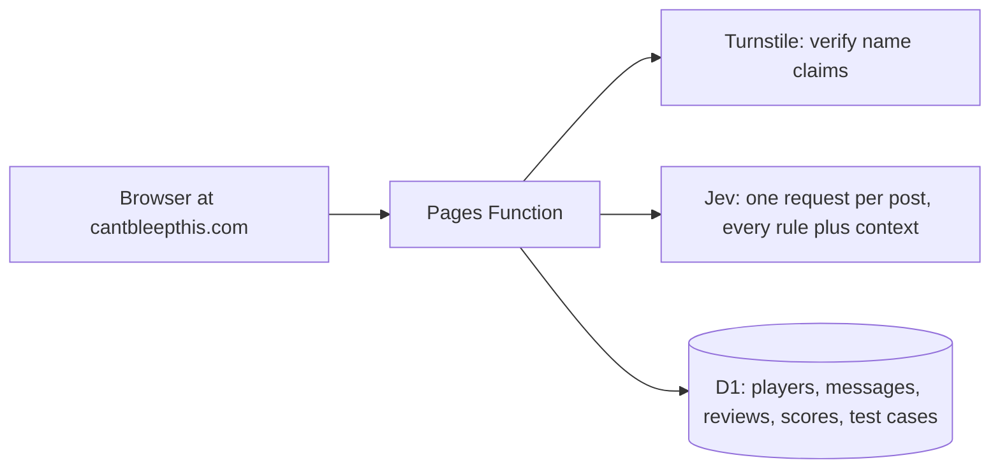

# PRD: Can't Bleep This

Indigo Grady · October 14, 2026

## Summary

**Can't Bleep This** is a just-for-fun chat game at cantbleepthis.com, listed and linked as a project on indigogrady.com. Players try to post inappropriate messages past a filter we design ourselves, and the other players are the judges, reviewing each message in the context of the chat around it.

Behind the fun, the goal is to design a better filter from scratch. Every message players judge becomes a labeled example with a reason, and the messages that got past the filter show exactly where it needs work.

Key decisions:

- **Name and domain:** Can't Bleep This at cantbleepthis.com.
- **Judges:** players, not a second AI. Anyone can judge any message, a review is required after a set number of posts that tightens as the queue grows, and 2 of 3 matching reviews decide each message.
- **Context:** the filter and the reviewers both see the last 10 messages and the usernames in the room, so "Elon is pro Al" is judged knowing Elon and Al are players.
- **Rules:** our own categories, including personal information (PII), for a general audience.
- **Identity:** no accounts. A username is claimed with a secret device token, plus Turnstile and lookalike-name blocking.
- **False positives:** blocked messages go through the same review queue, so players decide those too.
- **Storage and cost:** Cloudflare D1 on the free plan, the yearly domain fee, and about $0.0002 per filter check.

## Goals, non-goals and success measures

The goal is to design a better filter from scratch through play. Players supply both the attempts and the judgments, and the filter learns where it is wrong.

**Goals**

- Every judged message becomes a labeled example, with a rule and a reason, in a permanent test set.
- Fixes ship on a regular cycle (weekly to start), released only when they catch more without blocking more fine messages.
- The filter judges messages in context, the way a person in the room would.
- It feels like a game: reviewing and posting each take seconds, and the board rewards real slips.
- It runs at $0 a month on Cloudflare, plus the domain.

**Non-goals for v1**

- Accounts, passwords, email or social sign-in.
- A second AI judge. Players are the judges.
- Copying another product's filter, rules or wording.
- Private messages, multiple rooms, or a mobile app.

**Success measures**

| Measure | Target | Why it matters |
| --- | --- | --- |
| Filter catch rate on the test set | Rises with every release | The headline number for "the filter got better" |
| False-positive rate (blocked messages players judged fine) | Never rises after a release | A filter that blocks everything isn't better |
| Reviewer agreement (all 3 reviews match) | 70% or more | Low agreement means a rule is unclear |
| Confirmed slips per week | Steady or rising | The raw material for fixes |
| Patch time: confirmed slip to fix shipped | 2 weeks or less | Keeps the loop moving |
| Cloudflare cost | $0 | Keeps the project free to run |

## Starting point

The game is built in [cant-bleep-this](https://github.com/igrady2/cant-bleep-this) (formerly school-chat-filter), a cleaned-up version of an earlier filter-demo: a Next.js chat app on Cloudflare Workers that asks Jev, TypeSafe AI's classification model, one yes/no question per rule in its Terms of Use and blocks a message when any rule scores 0.5 or higher. It doesn't copy anyone else's filter, and the game keeps it that way. Jev is only the model; the rules, their wording and the thresholds are ours.

What changes for the game:

- **No school framing.** The Jev request describes a casual public chat game, and the rules are reworded for a general audience. Academic dishonesty is dropped.
- **Context.** Each check sends the last 10 messages with their usernames and the list of usernames in the room, not the message alone.
- **Our own rules.** The categories below replace the school ones, and personal information becomes its own rule.
- **Same plumbing.** Rate limits, the single Jev request and the 0.5 threshold carry over from the demo.

**No fallback.** The game only makes sense with Jev live, so the demo's offline keyword list is removed. If a check can't reach Jev (missing API key, error or timeout), the message is not posted and the player sees an error asking them to try again. A keyword layer may return later as a cheap fix for spelling tricks, but only alongside Jev, never in place of it.

## Our content rules

These are the categories the filter checks and reviewers choose from. They are a first draft; the wording of each becomes the Jev question.

| Rule | Covers | Note |
| --- | --- | --- |
| Harassment | Insults, mocking or targeting a player or a real person | Includes jokes aimed at a username in the room |
| Hate | Attacks on people for who they are | Race, religion, gender, sexuality, disability and similar |
| Sexual content | Sexual remarks, innuendo, explicit talk | Includes double meanings about players |
| Violence and threats | Threats, glorifying violence | Credible threats are off-limits (see below) |
| Self-harm | Encouraging self-harm | Supportive talk is fine |
| Profanity | Swearing, including disguised spellings |  |
| Personal information (PII) | Phone numbers, emails, addresses, full names of private people, account handles, revealing who a player is | New rule for our Terms of Use |
| Spam and scams | Links, ads, repeated text, fake offers |  |
| Impersonation | Pretending to be another player or a real person |  |

**Off-limits:** credible threats and any sexual content involving minors are removed on sight and never shown to anyone, reviewers included.

## Core loop

Players are the judges. Anyone can judge any message at any time, and a player who posts several messages in a row without judging is asked to review one before posting again. Those reviews are what catch slips: messages the filter let through that players say are not OK.

1. **Enter the room.** Confirm you are 18 or older and pick a username. The MVP has one shared room, a chat feed showing the newest 50 messages.
2. **Post.** Write up to 140 characters and send.
3. **The filter checks it in context**, with the last 10 messages and the usernames in the room. Passed messages appear in the feed. Blocked messages don't, and the author sees which rule they hit. If the filter can't be reached, nothing is posted and the author sees an error.
4. **Judge.** Tap **Judge** on any message in the feed, or take the next one from the queue. You see it with the 10 messages before it and their usernames, then choose **Fine** or **Not OK**. Not OK asks for a rule and one line on how it breaks it ("'pro Al' is a sexual joke about the player Al").
5. **Review requirement.** After a set number of posts without judging, the next post waits until you judge one message from the queue (see Review requirement below).
6. **Players decide.** Every message, passed or blocked, collects 3 reviews from players other than its author. The first 2 that agree set the verdict.

| Filter said | Players said | Verdict | What happens |
| --- | --- | --- | --- |
| Passed | Not OK | **Slip** | Author scores 1 point; the message is censored in the feed; it becomes a test case with the reviewers' reasons |
| Passed | Fine | Clean | Becomes a "should pass" test case |
| Blocked | Not OK | Caught | The filter was right; becomes a test case |
| Blocked | Fine | **False positive** | Becomes a "should pass" test case and is flagged for the maintainer |

Rules that keep it fair:

- **No self-review.** You never judge your own messages.
- **Hand-picked reviews are capped.** Messages you pick by hand count, but at most 1 of a message's deciding reviews can be hand-picked; the others come from the randomly assigned queue. This keeps friends from voting each other's slips through.
- **Known answers.** About 1 in 10 queue items is a seed message with a known verdict. Reviewers who miss several stop counting toward verdicts.
- **Skip is allowed.** You can skip a queue item you don't want to judge, and it still satisfies the review requirement.
- **20 posts per player a day.**
- **Board:** confirmed slips over the last 90 days, as a pure count. The rule each slip broke is saved, so weighting by rule later is easy.
- **Off-limits messages never reach a reviewer.** Phone numbers and email addresses are masked before anyone sees a message.

### Review requirement

Early on there is little to judge, so players start by posting; as the queue grows, the game asks for more judging. One setting, posts allowed between reviews (N), controls this.

| Messages waiting for review | Posts allowed before a review is required (N) |
| --- | --- |
| Fewer than 10 | No requirement |
| 10 to 49 | 5 |
| 50 to 199 | 3 |
| 200 or more | 1 |

The thresholds live in configuration, so the maintainer can tune them without a release. Judging any message by hand resets your count, so players who judge on their own never hit the requirement.

## How slips improve the filter

Each verdict goes to the maintainer for review, confirmed slips become fixes, and the board shows when a trick has been patched. The reviewers' reasons are what make this work: they say in plain words what the filter missed.

1. **Collect.** Each verdict saves the message, its 10-message context, the filter's score for every rule, the filter version, and each reviewer's rule and reason.
2. **Review.** The maintainer skims slips and false positives in an admin view, grouped by rule, and tags the trick: spelling (leetspeak, spacing, symbols), sound (homophones), meaning (innuendo, euphemism, new slang), or context (only bad given who is in the room).
3. **Fix.** Reword a rule's question, add an example to it, adjust its threshold, or add a normalization step for spelling tricks.
4. **Test.** The candidate filter runs against the whole test set: every confirmed slip should now be caught, and every clean message and false positive should still pass. It ships only if catches go up and false positives don't.
5. **Ship and show.** The new version (v2, v3, and so on) is stamped on every later message. Slips it now catches show "Patched in v3" on the board, and players keep their points.

The test set is the one thing kept past 90 days. Each case keeps the message, its context, its label and the reviewers' reasons, with usernames removed.

## Usernames and impersonation

**No accounts.** Each name is bound to a secret token on the player's device, lookalike names are blocked, and Turnstile protects name creation. Real sign-in would add friction and personal data for a problem a 20-posts-a-day game rarely has.

**Picking a name**

- 3 to 20 characters: letters, numbers and underscores.
- Checked by a word list, then a Jev `noul` question ("Is this username offensive or sexual, decoded for leetspeak?") at 0.5. Names are held to a stricter bar than messages because they show unredacted on the board.
- Reserved: indigo, indigogrady, admin, mod, jev, typesafe, filter, and similar.
- Unique after normalization: lowercase, and lookalikes folded together (l, 1 and I; 0 and o; 5 and s; rn and m), so "Indigo" blocks "lndigo" and "1ndig0".

**Owning a name**

- On claim, the server creates a random 32-byte token, stores only its SHA-256 hash, and returns the token to the browser, which keeps it in localStorage.
- Every review and post sends the token. Nobody can play as a name without it, so a taken name cannot be reused or impersonated.
- The claim screen shows the token once as a recovery code ("Save this to play from another device"). Lose it and you pick a new name.
- A name with no posts for 90 days is released, which matches the board window and stops squatting.
- Cloudflare Turnstile (free, no puzzle for most people) runs on the claim step so bots can't reserve names in bulk.

**Why not MAC or IP**

| Option | Verdict | Reason |
| --- | --- | --- |
| MAC address | Not possible | Browsers never expose it to websites. |
| IP address as identity | No | Shared by households, offices and mobile carriers; changes on phones and VPNs. It would lock out real people and let others in. |
| IP as a rate-limit signal | Yes, hashed | A salted hash caps name claims at 3 per IP per day without storing the address. |
| Device token (chosen) | Yes | Free, no personal data, and stops reuse of a taken name. |
| Passkey or Google sign-in | Later, if needed | Add only if impersonation becomes a real problem; the token design upgrades cleanly to it. |

## Censoring and false positives

**Censoring.** A message posts first and is censored once players confirm it as a slip. The feed then shows a masked version ("f\*\*\*"), or "█████" with the rule name when the offending part can't be isolated.

- Reviewers see the original, because judging it is their job. Entering the room shows a one-time note: "You'll judge messages other players wrote. Some will be offensive. You can skip any of them."
- Phone numbers, emails and long digit runs are masked before anyone sees a message, reviewers included.
- Off-limits messages are removed on sight and never posted or reviewed.

**False positives.** These are handled by the same queue rather than a report button. Blocked messages are reviewed like any other, and 2 of 3 "Fine" reviews make it a false positive. False positives never cost the author anything, and they count against the filter in the success measures.

## Architecture and free-plan fit

**Storage: Cloudflare D1, not KV.** D1 is a database, but it is free at this scale and needs no server; KV's 1,000 writes a day would cap the game at about 250 posts a day and can't rank a board without lost updates.

The game lives in the cant-bleep-this repo with its own Cloudflare Pages project at cantbleepthis.com, with its own D1 database, so it ships independently of indigogrady.com. A claim verifies Turnstile, checks the name and stores the token hash. A review saves a verdict. A post checks the token and daily caps, loads the last 10 messages, sends one Jev request with every rule and the context, and saves the result. The feed refreshes every 15 seconds while the tab is visible.

**Data model** (everything except the test set is deleted after 90 days; Pages Functions have no scheduler, so each write also runs a cheap indexed delete of expired rows)

| Table | Key fields | Kept for |
| --- | --- | --- |
| players | name, normalized name (unique), token hash, created, last played, reviewer standing | Until 90 days without a post |
| messages | author, text, masked text, ids of the 10 messages before it, filter score per rule, filter version, status (pending, slip, clean, caught, false positive), time | 90 days |
| reviews | message, reviewer, Fine or Not OK, rule, reason, skipped flag, time (one per reviewer per message) | 90 days |
| scores | player, day, slips (one row per player per day) | 90 days |
| test\_cases | message, context snapshot, expected verdict, rule, reasons, source (game or seed), version added | Permanently, with usernames removed |

The board is the sum of `scores` over the last 90 days, top 50, cached for 5 minutes. Summing daily rows keeps reads small no matter how many messages there are.

**Free-plan fit** (limits from Cloudflare's [D1](https://developers.cloudflare.com/d1/platform/pricing/) and [KV](https://developers.cloudflare.com/kv/platform/pricing/) pricing pages; limits reset at 00:00 UTC)

| Resource | Free limit per day | Use per post | Posts a day it allows |
| --- | --- | --- | --- |
| D1 rows written | 100,000 | about 4 (message, review, verdict, score) | about 25,000 |
| D1 rows read | 5,000,000 | a few dozen (queue, context, feed) | not the constraint |
| D1 storage | 5 GB total | about 1 KB a message with its reviews | years of data |
| KV writes (for comparison) | 1,000 | about 4 | about 250 |
| Function requests | 100,000 per account, shared with other projects | 2 to 3, plus feed refreshes | thousands of player-hours |

The site-wide cap of 2,000 posts a day (see Risks) trips long before any Cloudflare limit. Jev usage is the one cost Cloudflare doesn't cover. Measured cost is about $0.0002 a check (95 checks cost $0.021), so 100 posts a day is roughly $0.65 a month.

## Risks

The biggest risks come from players judging players: offensive content shown to reviewers, and people gaming the votes.

| Risk | Mitigation |
| --- | --- |
| Reviewers see offensive text | One-time content note, skip allowed, personal info masked, off-limits messages never shown |
| Friends vote each other's slips through | No self-review, at most 1 hand-picked review per verdict, 3 reviews per message, known-answer checks |
| Players target each other ("Elon is pro Al") | That's a slip by design and gets censored on verdict; the maintainer can delete any message and ban a username from the admin view |
| Low traffic leaves messages without verdicts | Seed messages, no review requirement until the queue builds up, and a late verdict still scores the slip |
| Visitors from indigogrady.com stumble into offensive content | The game lives on its own domain, and indigogrady.com only links to it; the landing page explains the game before anyone enters the room |
| Players try prompt injection ("ignore your rules") | The message is sent to Jev as data, never as instructions, and players review anything that gets through |
| Feed refreshes use up free requests | Refresh every 15 seconds only while the tab is visible; move the feed to a Durable Object with WebSockets if traffic grows |
| Jev cost grows | About $0.0002 per check, 20 posts per player a day, and a site-wide cap of 2,000 posts a day |

## Name

**Can't Bleep This**, at cantbleepthis.com, with the tagline "Get it past the filter." It says what you do (avoid the bleep), it's a familiar riff on "U Can't Touch This", and "Bleeped" doubles as the result when you're caught. Other names considered: Sneak It Past, Bleep Dodge, Slip Through and Filter Breaker. The name avoids the model vendor's brands so the game still works if the model changes.

## Milestones and decisions

1. **Rules:** finalize our content rules and their wording, and write about 100 seed messages with known verdicts.
2. **Filter in context:** change the demo's request to send the last 10 messages and the usernames in the room, swap in our rules, and test on the seed set.
3. **Build v1:** Pages project for the cant-bleep-this repo, username claim with Turnstile, room feed, review queue with context, posting, verdicts, censoring, board, admin view, test-set runner. Reviewed on a Cloudflare preview deploy.
4. **Private beta:** a few friends for a week; check reviewer agreement, slip rate and anything ugly.
5. **Launch:** point cantbleepthis.com at the Pages project, add a project entry on indigogrady.com that links to it, then run the review, fix and test cycle weekly.

**Decisions made**

| Question | Decision |
| --- | --- |
| Starting filter | [cant-bleep-this](https://github.com/igrady2/cant-bleep-this) (formerly school-chat-filter), reworked with our rules and chat context; no fallback when Jev is unreachable |
| Judging | Players judge; any message at any time, with a review required after N posts that tightens as the queue grows |
| Age | Players confirm they are 18 or older before entering |
| Rooms | One shared room for the MVP |
| Scoring | A pure count of confirmed slips; no reviewer board in the MVP |
| Storage | Cloudflare D1 on the free plan |
| Model cost | About $0.0002 per check (95 checks cost $0.021); not a concern at this scale |
| Domain | cantbleepthis.com |
| Hosting | The cant-bleep-this repo with its own Cloudflare Pages project, linked from indigogrady.com |
