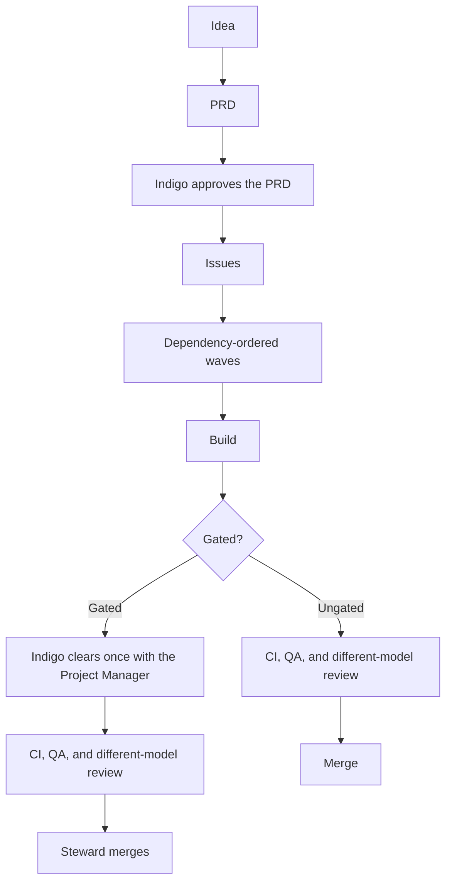

# Process

Indigo Grady owns the product. She approves the PRD, and she clears a gated pull request once. The game is specified in the [PRD](PRD.md). This page is how a change reaches `main`.

## Roles

| Role | What they do |
| --- | --- |
| Product owner | Indigo. Approves the PRD and clears each gated pull request once. |
| Project Manager | Orchestrates the work. Brings each gated pull request to Indigo once. |
| PRD Writer | Claude writes the PRD. |
| Issue Planner | Turns an approved PRD into issues. |
| Builder | Cursor, Codex, or Claude. A cheaper model takes the first pass. Cursor fast mode stays off. |
| QA / Test Runner | Checks the change. |
| Reviewer | A different model from the builder. |
| Steward | Merges a gated pull request after the checks pass, and records the review on the project board. |
| Release & Status | Build order, standups, and release notes. |

## Review routing

| Built with | Reviewed by |
| --- | --- |
| Cursor | Any model that did not build it, including Grok via Steward |
| Codex | Grok or Claude |
| Claude | Grok or ChatGPT |

## Flow

A pull request is gated when it changes moderation, schema, or auth, adds a dependency, affects cost, or changes more than about 400 lines of application code.

Ungated pull requests merge when CI, QA, and a different-model review have passed.

Gated pull requests are cleared once by Indigo, with the Project Manager. Steward merges after CI, QA, and a different-model review have passed. That clearance is the only ask.

## Paid API runs

A paid API run, such as a live seed baseline, waits for Indigo's approval and a call count.

## Traceability

Every pull request records **Built by model** and **Built by LLM**. Steward records **Reviewed by model** and **Reviewed by LLM** on the project board.

Labels: `built-by:cursor`, `built-by:codex`, `built-by:claude`, `built-by:grok`, `priority:high`, `priority:med`, `priority:low`, `size:S`, `size:M`, `size:L`, `blocked`, and `needs-approval`.

Milestones follow the PRD: `1 - Rules`, `2 - Filter in context`, `3 - Build v1`, `4 - Private beta`, `5 - Launch`.
