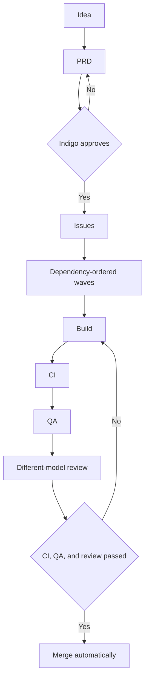

# Process

Indigo Grady is the product owner and the final approver. Agents write the PRD, plan the issues, build, test, and review. The game itself is specified in the [PRD](PRD.md). This page is how a change gets from an idea to `main`.

## Roles

| Role | Details |
| --- | --- |
| Product owner | Indigo. Final approver. |
| Project Manager | An AI that orchestrates the work. |
| PRD Writer | Claude. |
| Issue Planner | Turns an approved PRD into issues. |
| Builder | Cursor, Codex, or Claude. A cheaper model takes the first pass. Cursor fast mode stays off. |
| QA / Test Runner | Checks the change. |
| Reviewer | A more capable model than the builder, and a different model. |
| Release & Status | Build order, standups, and release notes. |

Review pairing:

| Built with | Reviewed by |
| --- | --- |
| Codex | Grok or Claude |
| Claude | Grok or ChatGPT |
| Cursor | Any model that did not build it |

## Flow

Issues list their dependencies, and waves follow that order. A pull request merges automatically once CI, QA, and review have all passed.

## Gates

- The PRD is scope-locked. Work outside it gets the `needs-approval` label.
- Splitting an issue needs approval.
- Escalation tripwires: about 400 lines changed, a new dependency, a schema, auth, or moderation change, or a cost impact.
- Each milestone exits with a preview deploy that Indigo checks.
- Branch protection comes after v1.

## Traceability

The pull request template records **Built by** and **Reviewed by**.

Labels: `built-by:*` (`built-by:cursor`, `built-by:codex`, `built-by:claude`, `built-by:grok`), `priority:high`, `priority:med`, `priority:low`, `size:S`, `size:M`, `size:L`, `blocked`, and `needs-approval`.

Milestones follow the PRD: `1 - Rules`, `2 - Filter in context`, `3 - Build v1`, `4 - Private beta`, `5 - Launch`.

## Usage discipline

- One issue per agent run.
- Minimal context on that run.
- Update [AGENTS.md](../AGENTS.md) when a working rule changes.
